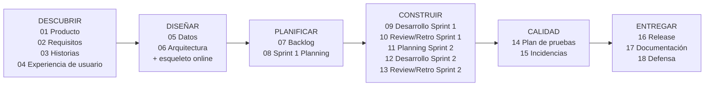

# Cómo funciona el Proyecto Intermodular

Vas a construir una aplicación web real **de principio a fin**, igual que lo haría un equipo en una empresa. En cada fase **te pones en la piel de un perfil profesional distinto** y produces algo concreto que se queda en este repositorio.

## El viaje: 18 fases, 6 bloques

| Fase | Hoy eres… | Al terminar tendrás… |
|---|---|---|
| 01 | Product Manager | El problema, los usuarios y el producto mínimo viable definidos |
| 02 | Analista funcional | Requisitos y reglas de negocio |
| 03 | Product Owner | Historias de usuario con criterios de aceptación |
| 04 | Diseñador/a de experiencia de usuario | Flujos, wireframes y prototipo navegable |
| 05 | Diseñador/a de datos | Modelo de datos **y la base de datos creada** |
| 06 | Arquitecto/a + DevOps | Arquitectura **y un esqueleto de la app publicado en una URL** |
| 07 | Product Owner | Product Backlog estimado y ordenado en el tablero |
| 08 | Equipo Scrum | Sprint 1 planificado |
| 09 | Desarrollador/a | Funcionalidades del Sprint 1 online |
| 10 | Equipo + cliente | Demo, feedback y una mejora de proceso |
| 11 | Equipo Scrum | Sprint 2 planificado con datos reales |
| 12 | Desarrollador/a | Funcionalidades del Sprint 2 online, sin romper lo anterior |
| 13 | Equipo + cliente | Producto completo para las pruebas |
| 14 | Tester | Plan de pruebas ejecutado y bugs registrados |
| 15 | Desarrollador/a de mantenimiento | Bugs corregidos y comprobados |
| 16 | DevOps / Release manager | Versión v1.0.0 en producción |
| 17 | Technical writer | README y guía de usuario que funcionan |
| 18 | Equipo ante el tribunal | Entrega y defensa |

## Reglas del juego

1. **Las fichas son este repositorio.** Cada fase tiene su documento en `docs/`. Lo rellenas aquí y haces commit. No hay papeles aparte.
2. **Las diapositivas explican, la ficha guía.** En clase verás la teoría y el ejemplo. La ficha solo te dice qué hacer y qué entregar.
3. **Cada fase usa lo anterior.** Si algo no encaja con una fase previa, se corrige allí y se anota. Eso es trabajo profesional, no un error.
4. **Lo que se hace, se ve.** A partir de la fase 07, la prueba de tu trabajo es el tablero, Git y la URL. La ficha solo enlaza.
5. **Nada aparece por arte de magia.** Todo lo que construyes viene de algo anterior. Lo controlas en [`TRAZABILIDAD.md`](TRAZABILIDAD.md).
6. **Mejor pequeño y funcionando que grande y a medias.**

## Cómo usar cada ficha

- Lee la cabecera: quién eres hoy y qué tendrás al terminar.
- Sigue los pasos y rellena las tablas. Borra las líneas que empiezan por 🧭 cuando ya no las necesites.
- Antes de entregar, revisa **✅ Hecho cuando** y comprueba que puedes responder a **🗣 Compruébalo**.
- Haz commit con un mensaje claro, por ejemplo `docs: completa fase 05 modelo de datos`.

## El ejemplo que verás en clase: ReservAula

Una aplicación web para que el profesorado del centro reserve aulas y espacios sin hojas de papel ni mensajes. La verás crecer fase a fase en las diapositivas: es el modelo, **no** la copies. Tu proyecto es tuyo.
